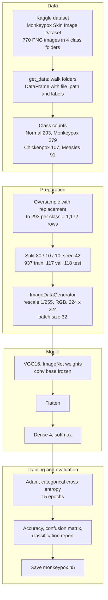
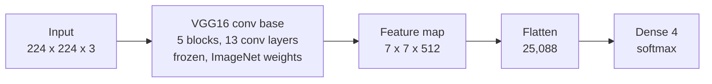

# Monkeypox-Classification

Four-class skin-lesion image classifier that separates **Monkeypox**, **Measles**, **Chickenpox** and **Normal** skin, built with transfer learning on a frozen **VGG16** (ImageNet weights) in TensorFlow/Keras.

## Dataset

The notebook trains on the Kaggle dataset **Monkeypox Skin Image Dataset** (`/kaggle/input/monkeypoxskinimagedataset`), one folder per class. The image folders in this repo are a 299-image sample of it, so the numbers below are from the full dataset as counted by the notebook.

| Class | Images in notebook | Sample in this repo |
|---|---|---|
| Normal | 293 | 100 |
| Monkeypox | 279 | 100 |
| Chickenpox | 107 | 58 |
| Measles | 91 | 41 |
| **Total** | **770** | **299** |

The classes are imbalanced (Chickenpox and Measles together are about a quarter of the data), which is why the notebook rebalances them before splitting.

## Architecture

### End-to-end pipeline



### Model



Only the final `Dense(4)` layer is trained. Parameter counts below are computed from the architecture (the notebook does not print `model.summary()`):

| Part | Parameters |
|---|---|
| VGG16 conv base (frozen) | 14,714,688 |
| Dense(4) head (trainable, 25,088 x 4 + 4) | 100,356 |
| Total | 14,815,044 |

## Methodology

1. **Load.** `get_data` walks the dataset folder and builds a DataFrame of `file_path` and `labels` (the folder name).
2. **Explore.** Class counts, a count plot, pie and donut charts, and a 4-images-per-class preview grid.
3. **Balance.** Every class is sampled with replacement up to 293 images, giving 4 x 293 = 1,172 rows.
4. **Split.** `train_test_split` with `random_state=42`: 80% train, then the remaining 20% halved into validation and test. Result: 937 / 117 / 118 images.
5. **Generators.** `ImageDataGenerator(rescale=1/255)` with `flow_from_dataframe`, `target_size=(224, 224)`, RGB, categorical labels, batch size 32, `shuffle=False`.
6. **Model.** VGG16 without its top, all layers frozen, then `Flatten` and `Dense(4, softmax)`.
7. **Train.** Adam (default settings), categorical cross-entropy, accuracy metric, 15 epochs, validation on the validation generator.
8. **Evaluate.** Loss and accuracy on train, validation and test; confusion matrix and classification report on the test set.
9. **Export.** `monkeypox.h5` saved with the optimizer state (the file is not committed to this repo).

### Hyperparameters

| Setting | Value |
|---|---|
| Input size | 224 x 224 x 3 |
| Pixel scaling | 1/255 |
| Batch size | 32 |
| Epochs | 15 |
| Optimizer / loss | Adam (defaults) / categorical cross-entropy |
| Base network | VGG16, ImageNet weights, frozen |
| Head | Flatten, Dense(4, softmax) |
| Split / seed | 80 / 10 / 10, `random_state=42` |

## Results

Values are read from the notebook's saved outputs.

| Split | Loss | Accuracy |
|---|---|---|
| Train | 0.0168 | 99.89% |
| Validation | 0.1188 | 95.73% |
| Test (118 images) | 0.1341 | 95.76% |

Validation accuracy rose from 82.9% at epoch 1 to 96.6% at epochs 11 and 12 and finished at 95.7%.

Test-set confusion matrix (rows = true class, columns = predicted; class indices 0 to 3):

|  | Pred 0 | Pred 1 | Pred 2 | Pred 3 |
|---|---|---|---|---|
| True 0 (26) | 25 | 1 | 0 | 0 |
| True 1 (29) | 0 | 29 | 0 | 0 |
| True 2 (24) | 1 | 0 | 22 | 1 |
| True 3 (39) | 0 | 2 | 0 | 37 |

| Class index | Precision | Recall | F1 | Support |
|---|---|---|---|---|
| 0 | 0.96 | 0.96 | 0.96 | 26 |
| 1 | 0.91 | 1.00 | 0.95 | 29 |
| 2 | 1.00 | 0.92 | 0.96 | 24 |
| 3 | 0.97 | 0.95 | 0.96 | 39 |
| Macro avg | 0.96 | 0.96 | 0.96 | 118 |

The notebook never prints `class_indices`. Keras normally orders classes alphabetically, so indices 0 to 3 are most likely Chickenpox, Measles, Monkeypox, Normal; verify with `test_ds.class_indices` before quoting per-class numbers.

## Running it

The notebook is written for a Kaggle notebook with a GPU and the dataset attached. To run it elsewhere, set `data` in the second cell to a folder that contains one sub-folder per class (this repo's four image folders work as a small sample), and install:

```bash
pip install tensorflow pandas numpy scikit-learn seaborn matplotlib pillow
```

## Known limitations

These affect how far the reported accuracy can be trusted.

- **Duplicate images across splits.** Oversampling with replacement happens before the train/validation/test split, so the 1,172 rows contain at most 770 distinct images and the same image can appear in both training and test. The validation and test accuracies are therefore likely optimistic. Splitting first and balancing only the training set avoids this.
- **Test set is small.** With 118 images, one extra mistake moves accuracy by about 0.85 points.
- **Augmentation is defined but unused.** `train_datagen` (rotation, flip, shear, zoom, shifts) is created, but `train_ds` is built from the plain `datagen`, so training runs without augmentation.
- **Class weights are computed but never passed to `fit`.**
- **Unused second model.** The small custom CNN (`model`, two Conv blocks and dense layers) is compiled but never trained; only the VGG16 model (`monkeypox`) is.
- **Preprocessing mismatch.** VGG16's ImageNet weights expect `tf.keras.applications.vgg16.preprocess_input`; the notebook uses `rescale=1/255` instead.
- **First cell does not parse.** `from tensorflow.keras.applications import VGG16,` ends with a trailing comma, which is a `SyntaxError`; the imports are repeated correctly in the third cell.
- **Pie and donut chart labels are mismatched.** The labels are hard-coded as Monkeypox, Measles, Normal, Chickenpox, but `value_counts()` returns Normal, Monkeypox, Chickenpox, Measles, so the slices are mislabeled.
- **Export cell.** `%cd kaggle/working` fails (the correct path is `/kaggle/working`) before the download link is created.

## License

MIT, see `LICENSE`.
